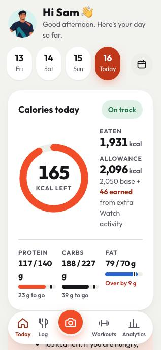
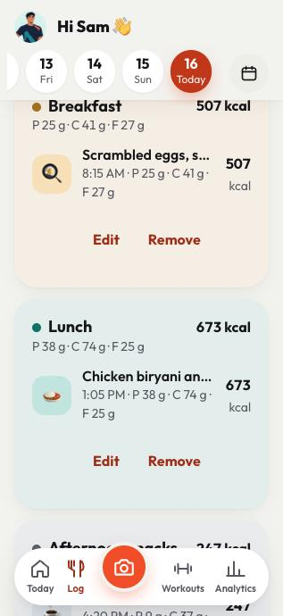
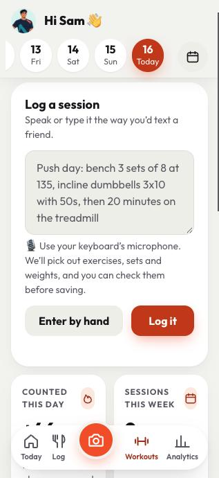
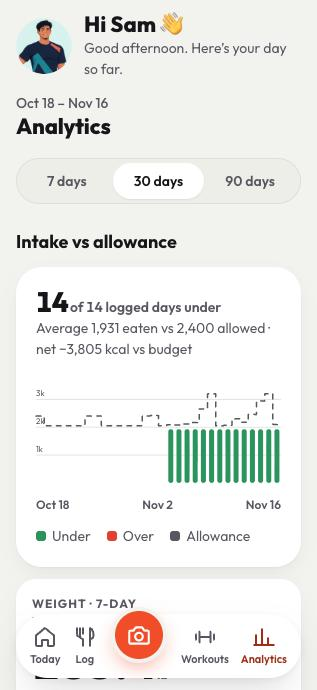
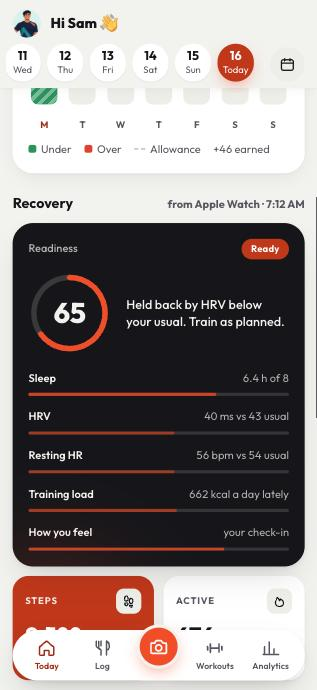
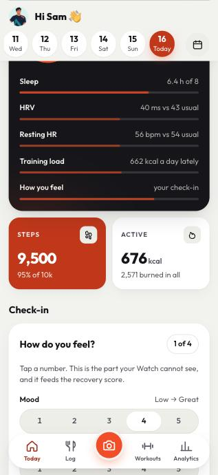
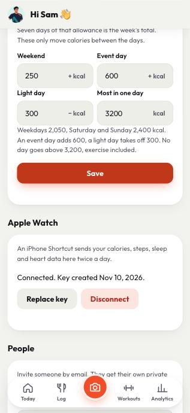

# Streak

A health tracker you run yourself. Photograph a meal and get calories and macros back; log
workouts by typing or talking; track weight against a goal; pull in Apple Watch data. It runs on
**your** Cloudflare account, with **your** API key, and nobody else can see your data — including
me.

Built as an everyday app for two people, then opened up. Free, no accounts, no analytics, no
upsell. Fork it, change it, ship your own version.

| Today | The Log | Workouts | Analytics |
|---|---|---|---|
|  |  |  |  |

---

## What it does

- **Snap a meal.** A photo goes to Claude from the server and comes back as a list of foods with
  amounts, which you can correct before saving. Typing or dictating works the same way.
- **One daily allowance.** Worked out from your height, age, activity and goal weight, then shaped
  across the week — heavier weekends, lighter weekdays, event days, a hard daily cap.
- **Workouts.** Describe a session in plain language; it becomes structured sets and an energy
  estimate that feeds back into the day's budget.
- **Apple Watch.** An iPhone Shortcut posts steps, active energy, exercise minutes, sleep and HRV.
  See below.
- **Analytics.** Weight trend against intake, training volume, and whether the week actually
  balanced.
- **Private per person.** Two people on one deployment each see only their own data.

It works offline and syncs when it can. Add it to your phone's home screen and it behaves like an
app.

## Apple Watch

There is no app to install on the Watch. An iPhone Shortcut reads from Apple Health and posts the
day's numbers to your own deployment, twice a day. Anything that can make an HTTPS request works
the same way, so this is not really iPhone-only — it is just the easiest way in.

| Readiness | What you did | Connecting it |
|---|---|---|
|  |  |  |

What it changes once connected:

- **Readiness** — sleep, HRV and resting heart rate read against *your* usual, not a population
  average, combined with recent training load and how you said you felt.
- **Your allowance moves.** Active calories above your baseline are earned back, at a share you
  choose, so a long walk shows up as food you can eat rather than a number you admire.
- **Watch workouts** are matched against sessions you logged by hand instead of double-counted.

Setting it up is one screen in the app and about ten minutes in Shortcuts — the payload is
documented in [SETUP.md](SETUP.md#7-apple-health-optional), so you can build it yourself rather
than trusting a downloaded Shortcut. It needs one extra Cloudflare Access rule, also in the guide,
because a Shortcut has no browser and cannot sign in.

Skip it entirely and the rest of the app is unaffected.

## The stack

Vanilla JavaScript ES modules. No framework, no bundler, no build step beyond a script that
inlines the static files into the Worker. The whole thing is a Cloudflare Worker, a D1 database
and Cloudflare Access for sign-in.

| | |
|---|---|
| **Hosting** | Cloudflare Workers — free tier |
| **Data** | Cloudflare D1 — free tier |
| **Sign-in** | Cloudflare Access, one-time email code — free up to 50 users |
| **Estimates** | Claude API — pay as you go, ~1–3¢ per estimate |

Running it costs nothing but the meal estimates, and those are capped per person per day so it
cannot run away from you.

## Bring your own keys

**Your keys stay yours.** Nothing here calls a service on my behalf, and deploying this does not
send anything to me.

The Claude API key is a Cloudflare secret, set once with `wrangler secret put` and readable only
by the Worker at runtime. It is never in a file, never in the git history, and never reaches the
browser — the front end has no idea it exists. Meal photos go to *your* Worker, which calls
Anthropic with *your* key and returns the result.

`wrangler.jsonc` — which holds your account, database and sign-in IDs — is gitignored.
`wrangler.example.jsonc` is the template you copy. If you fork this, your own deployment details
stay on your machine the same way.

## Get it running

**[SETUP.md](SETUP.md)** is the full walkthrough — about twenty minutes, most of it waiting.

The short version:

```bash
git clone https://github.com/<your-username>/daily-check-in.git
cd daily-check-in
npm install
cp wrangler.example.jsonc wrangler.jsonc
cp .dev.vars.example .dev.vars
npm run dev                  # http://localhost:8787, no Cloudflare account needed
```

That gets you the whole app locally. Deploying it, turning on sign-in and adding a Claude key are
steps 2–5 of SETUP.md.

## Building on it

The code is meant to be read. Every module is small, there is no indirection to chase, and the
comments explain *why* a thing is the way it is rather than restating what it does.

- **[DESIGN.md](DESIGN.md)** — the design system: tokens, components, and the rules behind them.
  Read it before changing the interface.
- **[CLAUDE.md](CLAUDE.md)** — the project's own notes on layout and conventions. Useful whether
  or not you code with an AI assistant.

```bash
npm test     # builds, then runs the suite
```

Some things it deliberately does not do: no social features, no streaks-as-guilt, no notifications
nagging you. It is a tracker, not a habit-shaming engine.

Issues and pull requests are welcome, but this is a side project — I may be slow. Forking is
completely fine and needs no permission; that is what the licence is for.

## Licence

MIT. Do what you like with it.
